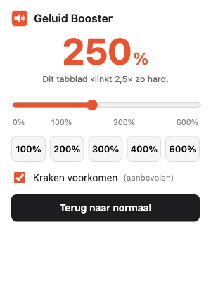

# 🔊 Geluid Booster voor Chrome

Is het geluid in Chrome te zacht, ook al staat Windows al op 100%?
Met **Geluid Booster** zet je een tabblad tot **6× zo hard** (600%).



- ✅ Geen installatie in Windows en geen beheerdersrechten nodig
- ✅ Werkt vanuit het mapje dat je downloadt: **mapje weg = programma weg**
- ✅ Geen account, geen reclame, er gaat niets naar internet
- ✅ Ingebouwde bescherming tegen kraken bij hoge standen

---

## Installeren (± 1 minuut)

1. **Download** de nieuwste versie: [**Geluid-Booster.zip**](../../releases/latest/download/Geluid-Booster.zip)
   (of klik hierboven op de groene knop **Code → Download ZIP**).
2. **Pak het zip-bestand uit**: rechtermuisknop op het bestand → **Alles uitpakken…**
   > Tip: zet het uitgepakte mapje op een vaste plek, bijvoorbeeld in **Documenten**.
   > Ruim je later je Downloads-map op, dan blijft de booster gewoon werken.
3. **Dubbelklik op `INSTALLEREN.bat`** in het mapje.
   Chrome opent de pagina met extensies en je krijgt de stappen te zien:
   1. Zet rechtsboven **Ontwikkelaarsmodus** aan.
   2. Klik op **Uitgepakte extensie laden**.
   3. Klik in de adresbalk van het venster, druk op **Ctrl+V** en **Enter**, en klik op **Map selecteren**.
      (Het pad is al gekopieerd door `INSTALLEREN.bat`.)
4. Klik in Chrome rechtsboven op het **puzzelstukje** 🧩 en dan op de **punaise** 📌 naast *Geluid Booster*.
   Nu staat het oranje luidspreker-icoontje altijd in beeld.

> **Windows waarschuwt "Windows heeft uw pc beveiligd"?**
> Klik op **Meer informatie** → **Toch uitvoeren**. Het bestand opent alleen Chrome en kopieert het pad.
> Liever niet? Typ dan zelf `chrome://extensions` in Chrome en kies bij stap 3 het mapje **extensie**.

## Gebruiken

1. Ga naar het tabblad met geluid (YouTube, Netflix, een vergadering in de browser, …).
2. Klik op het **oranje luidspreker-icoontje**.
3. Schuif naar rechts, of klik op **200%**, **300%**, **400%** of **600%**.

Het getal op het icoontje laat zien hoe hard dat tabblad staat.
Met **Terug naar normaal** zet je het weer op gewoon geluid.
Elk tabblad heeft z'n eigen stand.

**Kraken voorkomen** (staat standaard aan) vangt de hardste pieken op zodat het geluid
niet gaat vervormen. Zet het uit als je het maximale volume wilt en vervorming niet erg vindt.

## Verwijderen

Gooi het mapje weg. Klaar.
Chrome meldt daarna mogelijk dat de extensie ontbreekt; op `chrome://extensions` kun je dan op
**Verwijderen** klikken om ook die melding weg te halen.

## Veelgestelde vragen

**Het werkt niet op deze pagina.**
Op interne Chrome-pagina's (zoals instellingen of de Web Store) kan het niet. Op gewone websites wel.

**Ik krijg de melding dat het tabblad al wordt opgenomen.**
Er gebruikt al iets anders het geluid van dit tabblad (bijvoorbeeld scherm delen in Teams/Meet,
of een andere volume-extensie). Stop dat eerst, of schakel de andere extensie uit.

**Ik zie een klein icoontje in het tabblad.**
Dat is normaal: Chrome laat zien dat het geluid van dat tabblad via de booster loopt.

**Blijft de stand bewaard?**
Zolang het tabblad openstaat wel, ook als je naar een andere pagina gaat. Sluit je het tabblad
of Chrome, dan begint het weer op 100%.

**Werkt het ook in Microsoft Edge?**
Ja: ga in Edge naar `edge://extensions`, zet **Ontwikkelaarsmodus** aan en kies **Uitgepakte laden**.

## Hoe werkt het?

Het is een Chrome-extensie (Manifest V3). Bij het eerste gebruik op een tabblad vangt de extensie
het geluid van dat tabblad op (`chrome.tabCapture`), stuurt het door een versterker
(Web Audio `GainNode`, 0–600%) en eventueel een limiter (`DynamicsCompressorNode`), en speelt het
weer af. Er wordt niets opgeslagen of verstuurd.

```
extensie/
  manifest.json    instellingen van de extensie
  popup.html/js/css  het venstertje met de schuifregelaar
  background.js    houdt bij welke tabbladen versterkt worden
  offscreen.*      waar het geluid echt versterkt wordt
INSTALLEREN.bat    opent Chrome en kopieert het pad (voor stap 3)
ontwikkeling/      icoontjes-script en screenshot (niet nodig om te gebruiken)
```
